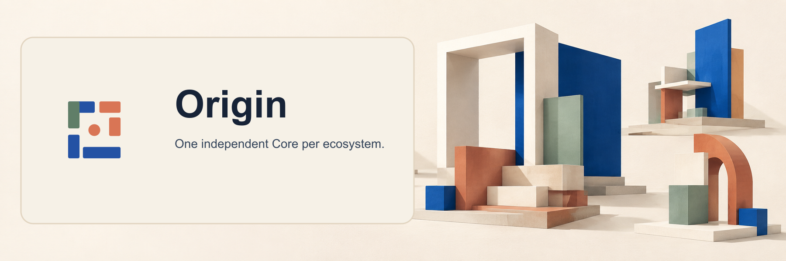

  

  # Origin

  **A Laravel starter-kit ecosystem for independent product systems.**

  Each product ecosystem has its own Core account authority, with connected applications retaining their own product data.

  [Project overview](https://github.com/origin-package/origin) ·
  [Documentation map](https://github.com/origin-package/origin/blob/ai/dpp-010-acceptance/docs/README.md) ·
  [Version matrix](https://github.com/origin-package/origin/blob/ai/dpp-010-acceptance/docs/VERSION-MATRIX.md)

  **Experimental, pre-1.0; not approved for public or production use.**

